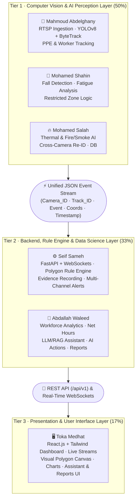
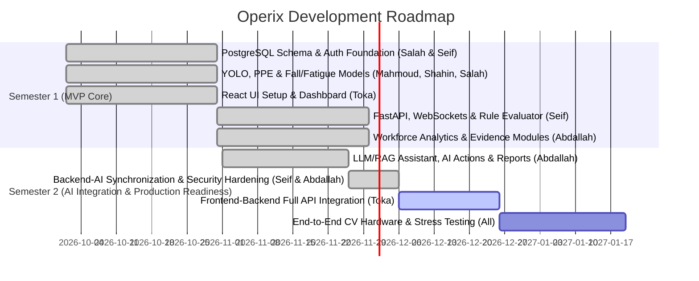

<div align="center">

# 🚀 OPERIX
### Multi-Department Industrial Operations, Custom Constraints & Safety Intelligence Platform

[](https://www.python.org/)
[](https://fastapi.tiangolo.com/)
[](https://react.dev/)
[](https://www.postgresql.org/)
[](https://redis.io/)
[](https://ultralytics.com/)

*Enterprise-grade Computer Vision, Deterministic Rule Evaluation, Workforce Analytics, and Bilingual LLM/RAG Intelligence — built on existing RTSP CCTV & Thermal camera networks.*

[📚 API Docs](./docs/frontend-integration/README.md) • [🔌 OpenAPI Spec](./docs/frontend-integration/openapi.json) • [✅ Frontend Checklist](./docs/frontend-integration/frontend-integration-checklist.md)

</div>

---

## 📌 Executive Summary

**Operix** transforms standard industrial **RTSP CCTV and Thermal cameras** into a unified, multi-tenant safety and operations intelligence platform — eliminating the need for proprietary hardware upgrades.

| Capability | Technology | Outcome |
| :--- | :--- | :--- |
| 🛡️ **Safety & PPE Compliance** | `YOLOv8` + `ByteTrack` + Pose/Fatigue + Thermal | Real-time detection of PPE violations, falls, fatigue, fire/smoke & restricted zone intrusions |
| 📐 **No-Code Polygon Rules** | Visual Canvas + Deterministic Policy Engine | Department-specific spatial zones & configurable thresholds without touching code |
| ⏳ **Workforce Analytics** | Canonical SQLAlchemy + RLS Scoped Queries | Net working hours, attendance activity, resolution KPIs & camera coverage gaps |
| 🔐 **Incident Evidence** | Factory-Scoped Storage + `SHA-256` | Tamper-evident snapshots & clips with cryptographic integrity verification |
| 🤖 **Bilingual RAG & AI Actions** | Bilingual (`AR`/`EN`) RAG + `AIActionService` | Grounded operational Q&A, source citations & RBAC-protected remediation actions |
| 📄 **Automated Reports** | PDF & Excel Export Engine | Tenant-isolated Workforce, Incident, Camera Coverage & Safety reports |

---

## 🏗️ 3-Tier Event-Driven Architecture



---

## 🧩 Core Platform Modules

### 1️⃣ No-Code Polygon Rule Builder & Constraints Engine
Administrators draw custom spatial polygon zones on camera views and bind department-level rules (`ppe_violation`, `restricted_zone_intrusion`, `fall`, `fire`, `smoke`, `temperature_anomaly`) with configurable confidence and duration thresholds.

### 2️⃣ Workforce Analytics & Net Working Time
Reconstructs net productive hours, worker activity, incident resolution efficiency, and camera uptime / unobserved monitoring gaps per factory:

$$
T_{net} = T_{presence} - T_{idle} - T_{approved\_breaks}
$$

### 3️⃣ Incident Evidence & Cryptographic Integrity
Stores event snapshots and clips in factory-isolated paths with `SHA-256` checksum verification (`POST /api/v1/evidence/{id}/verify-integrity`) and strict path-traversal containment.

### 4️⃣ Bilingual LLM/RAG Assistant & Agentic AI Actions
Supervisors and managers query safety rules and operational logs in **Arabic or English** (`POST /api/v1/assistant/ask`) with grounded citations, conversation ownership enforcement, and RBAC-validated remediation execution (`POST /api/v1/assistant/actions/execute`).

### 5️⃣ Automated Reports Generation
Generates factory-scoped **PDF** and **Excel** reports across Workforce, Incident, Camera Coverage, and Comprehensive Safety domains (`POST /api/v1/reports/generate`).

---

## 👥 Team Architecture & Role Distribution

<table>
  <thead>
    <tr>
      <th>Tier</th>
      <th>Member</th>
      <th>Role</th>
      <th>Core Responsibilities</th>
    </tr>
  </thead>
  <tbody>
    <tr>
      <td rowspan="3" align="center"><b>Tier 1</b><br/>CV &amp; AI Perception<br/><code>50%</code></td>
      <td><b>Mahmoud Abdelghany</b></td>
      <td>CV/IoT Pipeline Engineer</td>
      <td>RTSP Live Stream Ingestion, YOLOv8 + ByteTrack Detection &amp; Tracking, PPE Detection, System Integration.</td>
    </tr>
    <tr>
      <td><b>Mohamed Shahin</b></td>
      <td>Computer Vision &amp; Safety AI Engineer</td>
      <td>Fall Detection (Pose/Motion), Fatigue Analysis (Eye Closure, Yawning, Head Pose), Restricted Zone Logic, Dataset Curation.</td>
    </tr>
    <tr>
      <td><b>Mohamed Salah</b></td>
      <td>CV, Thermal AI &amp; Database Engineer</td>
      <td>Fire &amp; Smoke Detection, Thermal Sensor/Camera Analytics, Cross-Camera Re-ID, PostgreSQL Database Management.</td>
    </tr>
    <tr>
      <td rowspan="2" align="center"><b>Tier 2</b><br/>Backend &amp; Data Science<br/><code>33%</code></td>
      <td><b>Abdallah Waleed</b></td>
      <td>Team Lead, Data Science &amp; AI Assistant Engineer</td>
      <td>Workforce Analytics &amp; Net Working Hours, LLM/RAG AI Assistant, Agentic AI Actions, Automated Reports (PDF/Excel), Evidence Integration.</td>
    </tr>
    <tr>
      <td><b>Seif Sameh</b></td>
      <td>Backend &amp; Rule Engine Engineer</td>
      <td>FastAPI REST &amp; WebSockets Server, No-Code Polygon Rule Builder &amp; Evaluator, Evidence Recording, Multi-Channel Alerts (Telegram/SMS/Email).</td>
    </tr>
    <tr>
      <td align="center"><b>Tier 3</b><br/>Frontend UI/UX<br/><code>17%</code></td>
      <td><b>Toka Medhat</b></td>
      <td>Frontend &amp; UI/UX Engineer</td>
      <td>Interactive React.js Dashboard, Live Streams &amp; Alert Popups, Visual Polygon Zone Canvas, Analytics Charts, Evidence, Reports &amp; Assistant UI.</td>
    </tr>
  </tbody>
</table>

---

## 🛠️ Quick Start & API Documentation

| Resource | Link |
| :--- | :--- |
| **Frontend Integration Hub** | [`docs/frontend-integration/README.md`](./docs/frontend-integration/README.md) |
| **OpenAPI 3.x Specification** | [`docs/frontend-integration/openapi.json`](./docs/frontend-integration/openapi.json) (`32` paths · `21` Frontend endpoints) |
| **JS Fetch Client Examples** | [`docs/frontend-integration/frontend-api-examples.js`](./docs/frontend-integration/frontend-api-examples.js) |
| **Frontend Integration Checklist** | [`docs/frontend-integration/frontend-integration-checklist.md`](./docs/frontend-integration/frontend-integration-checklist.md) |

<details>
<summary><b>⚡ Local Development Run Commands</b></summary>

```bash
# 1. Backend (from backend/)
pip install -r requirements.txt
uvicorn app.main:app --host 0.0.0.0 --port 8000 --workers 1

# 2. Frontend (from Frontend/)
npm install
npm run dev
```

</details>

---

## 🗓️ Two-Semester Roadmap


