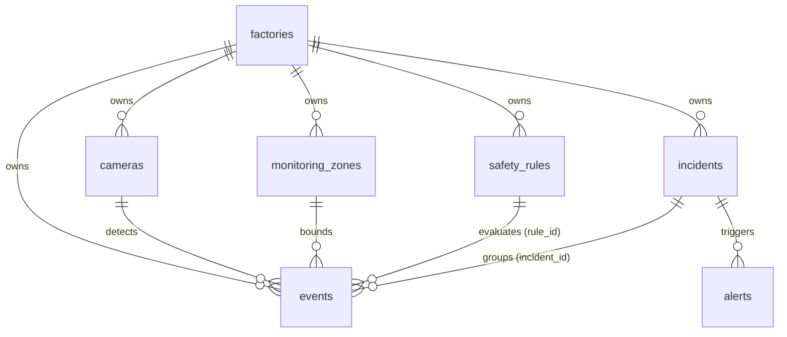

# OPERIX — AI BACKEND INTEGRATION CONTRACTS
## Integration Specification for Abdullah's Four AI Services

**Target Audience:** AI Engineering Team (Abdullah Waleed)  
**Status:** APPROVED & TESTED  
**Version:** 1.0.0 (Phase 3.6 Final)  

---

## 1. Architectural Principles & Rules of Engagement

1. **Shared Database Architecture:**
   - External AI services MUST NOT create independent database engines, custom connection pools, or direct socket connections to PostgreSQL.
   - Always consume the existing FastAPI dependency injection (`db: Session = Depends(get_db)` or `get_tenant_db`).
2. **Transaction Ownership:**
   - The SQLAlchemy `Session` lifecycle is owned by the request/caller context.
   - AI service helpers MUST NOT call `db.commit()`, `db.rollback()`, or `db.close()` on caller-provided sessions.
3. **Strict Multi-Tenant Scoping:**
   - Operix enforces factory isolation at the database layer.
   - All queries executed by AI sub-modules MUST include `.where(Model.factory_id == current_factory_id)`.
   - Never query or filter across factory boundaries.
4. **Zero Unapproved DDL:**
   - AI modules MUST NOT attempt runtime migrations or execute DDL (`CREATE TABLE`, `ALTER TABLE`).

---

## 2. Core Data Models & Relationships

The following database models in `app.models` provide the canonical entities:



### Key Columns for AI Modules:
- **`Event` (`app.models.incidents.Event`):**
  - `id`: UUID (Primary Key, producer-supplied).
  - `factory_id`: UUID (Tenant scope).
  - `event_type`: Enum (`EventType`).
  - `camera_id`: Optional UUID.
  - `zone_id`: Optional UUID.
  - `rule_id`: Optional UUID referencing the primary triggered `SafetyRule`.
  - `incident_id`: Optional UUID referencing an associated `Incident`.
  - `confidence`: Optional float [0.0, 1.0].
  - `detected_at`: DateTime (UTC).
  - `details`: JSONB containing raw CV metadata (`raw_bbox`, `frame_index`, `raw_camera_tag`, attributes, and `"rule_evaluation"` summary).
- **`SafetyRule` (`app.models.operational.SafetyRule`):**
  - `id`: UUID.
  - `name`: String (Title).
  - `event_type`: Target `EventType`.
  - `severity`: `SeverityLevel` (`low`, `medium`, `high`, `critical`).
  - `min_confidence`: Optional minimum confidence threshold.
  - `min_duration_s`: Optional duration threshold.
  - `threshold_value`: Optional sensor metric threshold.
  - `notify`: Boolean alert flag.
  - `version`: Integer (increments on update).

---

## 3. Typed Contracts for AI Services

The contracts reside in `app.schemas.rules` and `app.services.rule_evaluation_service`:

### 3.1 `RuleEvaluationResult` (Service Return Type)
Returned by `RuleEvaluationService.evaluate_event(db, factory_id, event)`:
```python
@dataclass
class RuleEvaluationResult:
    event_id: uuid.UUID
    factory_id: uuid.UUID
    event_type: EventType
    evaluated_rule_ids: List[uuid.UUID]
    matched_rule_ids: List[uuid.UUID]
    unmatched_rule_ids: List[uuid.UUID]
    matches: List[RuleMatchDetail]
    execution_records: List[RuleExecutionRecord]
    violations: List[RuleViolation]
    evaluation_status: str  # 'evaluated', 'no_rules_configured'
    matched_highest_severity: Optional[SeverityLevel]
    event_context: Dict[str, Any]
```

### 3.2 `RuleExecutionRecord` (Audit Contract)
Represents the evaluation outcome of an individual rule against an event:
```python
class RuleExecutionRecord(BaseModel):
    event_id: uuid.UUID
    factory_id: uuid.UUID
    rule_id: uuid.UUID
    rule_name: str
    rule_version: int
    evaluated_at: datetime
    is_matched: bool
    rejection_reason: Optional[str]  # None, 'scope_mismatch', 'confidence_below_threshold', 'duration_insufficient', 'threshold_metric_unmet'
    scope_type: str                  # 'global', 'zone', 'department', 'sensor'
    severity: SeverityLevel
    threshold_values: Optional[dict] # {'min_confidence': ..., 'min_duration_s': ..., 'threshold_value': ...}
    execution_status: str            # 'completed', 'skipped', 'failed'
```

### 3.3 `RuleViolation` (Violation Stream Contract)
Represents a confirmed violation for consumption by analytics and reporting:
```python
class RuleViolation(BaseModel):
    violation_id: uuid.UUID
    event_id: uuid.UUID
    factory_id: uuid.UUID
    rule_id: uuid.UUID
    rule_name: str
    rule_version: int
    incident_id: Optional[uuid.UUID]
    event_type: EventType
    severity: SeverityLevel
    violation_status: str            # 'detected', 'correlated', 'alerted'
    detected_at: datetime
    scope_type: str
    camera_id: Optional[uuid.UUID]
    zone_id: Optional[uuid.UUID]
    sensor_id: Optional[uuid.UUID]
    confidence: Optional[float]
    details: Optional[dict]
```

---

## 4. Module-Specific Integration Specifications

### 4.1 Module 1: Workforce Analytics (Safety Compliance Scoring)
- **Primary Input:** Consumes historical `Event` queries and real-time `RuleViolation` instances.
- **Consumption Interface:**
  - Query via existing REST: `GET /api/v1/events?event_type=...`
  - Internal Service: Inject `db: Session`, query `Event` filtered by `factory_id` and date range.
- **Scoring Logic:**
  - Read `event.rule_id` and `event.details["rule_evaluation"]["highest_severity"]`.
  - Calculate frequency of high/critical violations per `zone_id` and `department_id`.
- **Tenant Rule:** Never aggregate metrics across multiple factories.

### 4.2 Module 2: RAG Assistant (Root Cause & Policy Q&A)
- **Primary Input:** Safety rule definitions (`SafetyRule`), event details, and `RuleExecutionRecord.rejection_reason`.
- **Consumption Interface:**
  - Query `SafetyRule` definitions using `RuleService.get_rule` or `db.get(SafetyRule, id)`.
  - Ingest `rejection_reason` to explain to safety managers *why* an event was or was not flagged as a violation.
- **Context Injection:** When answering questions, inject `rule.name`, `rule.min_confidence`, and `rule.version` to ground responses in factory policy.

### 4.3 Module 3: Automated Incident Reports Generation
- **Primary Input:** `Event`, `Incident`, and `RuleViolation`.
- **Consumption Interface:**
  - Query `Event` where `incident_id == target_incident_id`.
  - Extract `details["rule_evaluation"]` to list all safety rules violated within the incident.
- **Output:** Formats PDF/HTML executive incident summaries for OSHA/regulatory audit.

### 4.4 Module 4: Incident Evidence Packaging
- **Primary Input:** `Event.details` bounding boxes and timestamps.
- **Consumption Interface:**
  - Retrieve `Event` by ID.
  - Extract `details["raw_bbox"]`, `details["frame_index"]`, `details["raw_camera_tag"]`, and `detected_at`.
  - Package reference video clips or image crops into `EvidenceFile` storage keys formatted as `f/{factory_id}/{event_id}/{filename}` (per database check constraint `ck_evidence_storage_key_pattern`).

---

## 5. Persistence vs. In-Memory Boundaries

| Data Artifact | Database Persisted | In-Memory Contract Only | Notes |
| :--- | :---: | :---: | :--- |
| **`Event.rule_id`** | ✅ | — | Primary (highest severity) matched rule ID. |
| **`Event.details["rule_evaluation"]`** | ✅ | — | Summary of matched rules, count, highest severity, notify flag. |
| **`RuleExecutionRecord` (Full History)** | ❌ | ✅ | In-memory return & WebSocket. Permanent storage requires future table approval. |
| **`RuleViolation` Entities** | ❌ | ✅ | In-memory return & WebSocket. Standalone table requires future approval. |
